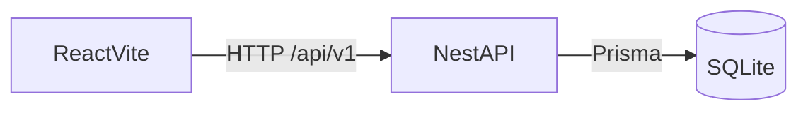
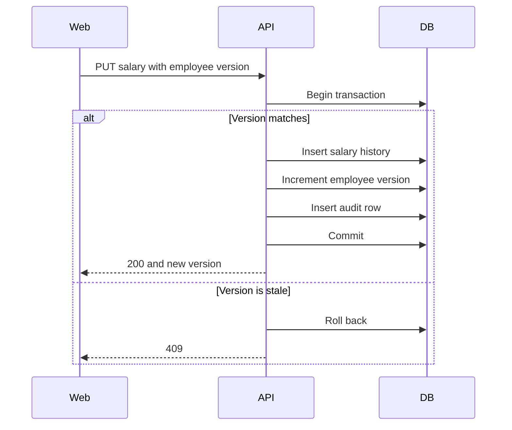
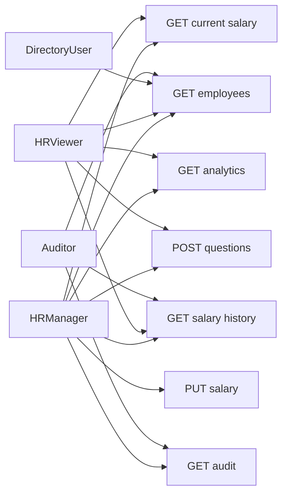

# Architecture

Salary Management is a modular monolith. `apps/api` is a NestJS service with Prisma and SQLite. `apps/web` is a React and Vite client. npm workspaces tie them together. There is no shared package: the API owns its DTOs, and the web app keeps its own response types until a type is actually imported by both sides.

## Modules

The API is split into auth, employees, salary, analytics, questions, audit, and health. Questions interpret text into a structured intent and then call the analytics service. They do not calculate medians, averages, or distributions themselves. The rule-based interpreter is the only interpreter in this scaffold. An LLM adapter is intentionally absent.

Salary updates, history inserts, and audit inserts run in one Prisma transaction. A stale employee version returns 409 and writes nothing. Money is stored as integer minor units. Median, average, and percentiles are computed in the analytics service because SQLite has no decimal or median type.

## Access

Demo users are seeded local accounts with bcrypt password hashes. JWTs expire after 15 minutes. Directory responses include current salary only for HR Manager and HR Viewer. Analytics and questions are limited to those two roles. Audit is limited to HR Manager and Auditor. Salary history is also visible to the Auditor.

Search stores a Unicode case-folded copy of each name (`firstNameKey`, `lastNameKey`) because SQLite `LIKE` is only case-insensitive for ASCII.

## Diagrams

The browser talks only to the API. Prisma is the only writer to SQLite.

A salary update is one transaction. A stale version rolls back and returns 409.

Question text becomes a structured intent. The analytics service calculates the figures.

Every signed-in role can open the directory. Salary fields on that response are limited to HR Manager and HR Viewer. The other routes are role-gated in the API.

## Trade-offs

The choices and their costs are written up in [TRADEOFFS.md](TRADEOFFS.md).

## Known limitations

Bulk import, approval workflow, currency conversion, and production single sign-on are out of scope. Group suppression defaults to five employees and is configured with `ANALYTICS_MIN_GROUP_SIZE`. Distribution buckets are 5,000,000 minor units wide.
